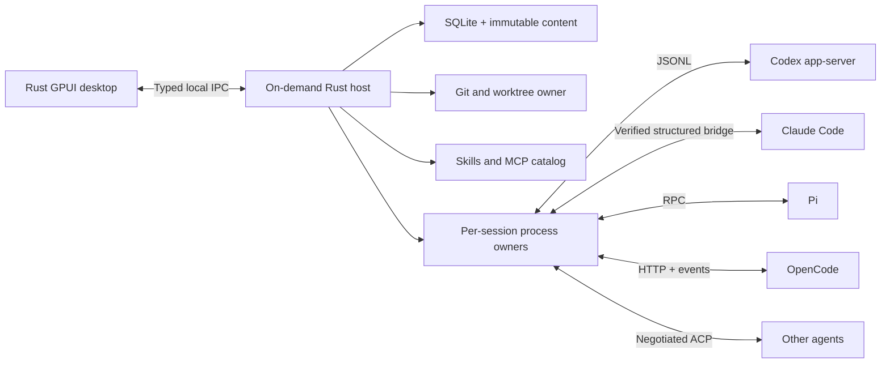

# Kodem architecture

Selected design, 9 September 2026. This is a specification, not compiled application source. Dependency compilation is reported separately.

## Caller workflow

A user opens a repository, starts a task, reads the streamed conversation, selects exact changed lines, and sends a review packet. Closing a window leaves active work with the local host. Reopening reconstructs the view from persisted state.

The desktop requests complete operations. It never coordinates Git locks, provider initialization, persistence transactions or event acknowledgement itself.

```rust
// Proposed call sites, not executable application code.
let task = workspace.start_task(StartTask {
    project,
    runtime,
    checkout: CheckoutChoice::NewWorktree,
    input: draft,
}).await?;

let subscription = workspace.watch_task(task, resume_cursor).await?;
let diff = workspace.capture_diff(task, comparison).await?;
let attachment = diff.select(selection_endpoints)?;
workspace.submit(task, Submission::Feedback { attachment, comment }).await?;
```

## Process and module ownership

Use an on-demand Rust host packaged with the native desktop. The host owns runs; windows own presentation. Start with three crates at most.

```text
crates/
  kodem-core/
    task/          task identity, commands, events, submission lifecycle
    runtime/       codex, claude, pi, opencode, acp adapters
    review/        Git capture, diffs, review selections, mutation preconditions
    catalog/       skill and MCP observations and source resolution
    storage/       SQLite, migrations, transcript chunks, content blobs
  kodem-host/
    main.rs        process lifecycle, IPC, durable event ingestion
  kodem-desktop/
    main.rs        GPUI-CE application
    ui/            shell, sidebar, chat, composer, review, terminal, settings
    ui/git/        Git workspace: repositories, history, changes, branches, pull requests
    components/    single GPUI Kit compatibility boundary and design tokens
  kodem-git/       Git workspace engine: Git commands, GitHub, AI service, settings
```

Extract further crates only for a useful dependency or build boundary. The host has no GPUI dependency. The desktop never imports provider wire types or SQL rows.

`kodem-git` is the one extracted crate. It holds the Git workspace's engine, which came from the standalone Liquid Git client: Git commands and their parsed models, commit graph layout, cloning with progress, GitHub requests through `curl` and the GitHub CLI, the AI service for commit messages and reviews (Ollama over HTTP or the Codex CLI), and the workspace's saved settings. It has no GPUI dependency, so it builds once and stays out of the desktop's unoptimized debug build. The Git workspace in `kodem-desktop/src/ui/git/` runs its calls on GPUI background threads in the desktop process rather than through the host: they act on the user's own checkouts at the user's request, belong to no task run, and Liquid ran them the same way. Git, curl and the CLIs it starts get Kodem's tool search path and no console window on Windows.



GPUI performs layout and rendering on its foreground executor. Blocking Git, filesystem, database and process work runs outside that thread. Each provider session has one owner for transport, request IDs, parsing, cancellation and stdout/stderr draining. One storage writer commits normalized records. Only that boundary assigns Kodem event sequence numbers and publishes durable updates.

## Domain shape

Keep task, runtime, model, conversation, turn, worktree, review snapshot and submission identities separate. Each task can have a sequence of provider sessions after explicit handoff. A model change is not a provider-session migration.

```rust
struct TaskId(Uuid);
struct RuntimeId(Uuid);
struct SubmissionId(Uuid);
struct SnapshotId(ContentDigest);

enum Support<T> {
    Available(T),
    Unavailable { reason: UnavailableReason },
}
enum Delivery {
    Draft,
    Queued,
    Submitted { receipt: ProviderReceipt },
    Unknown { command: SubmissionId },
    Failed { reason: Failure },
}
enum RunState {
    Idle,
    Running { turn: TurnId },
    WaitingForInput { turn: TurnId, requests: NonEmpty<InputRequest> },
    Interrupted { recovery: Recovery },
    Finished { result: RunResult },
}
struct Capabilities {
    resume: Support<ResumeContract>,
    steer: Support<SteerContract>,
    approvals: Support<ApprovalContract>,
    skills: Support<SkillCatalogContract>,
    mcp: Support<McpCatalogContract>,
    attachments: SupportedContent,
}
enum DiffLine {
    Context { old: LineNumber, new: LineNumber, text: TextRef },
    Removed { old: LineNumber, text: TextRef },
    Added { new: LineNumber, text: TextRef },
}
struct ReviewSelection {
    snapshot: SnapshotId,
    file: FileDeltaId,
    side: DiffSide,
    range: ValidatedLineRange,
}
enum SubscriptionStart {
    Snapshot { state: TaskView, through: EventSeq },
    Replay { after: EventSeq },
    ReplayGap { current: TaskView, through: EventSeq },
}
```

Constructors validate external IDs, paths, ranges and protocol payloads at boundaries. UI selection cannot construct an invalid range. Pending approvals include runtime session, turn and request identity. Verification is a separate record tied to revision and environment, not a synonym for run completion.

The main operations are start task, submit typed user intent, capture diff, and subscribe to task state. They hide process lifecycle and durable ordering without exposing a generic string-command bus. Internal pure functions handle diff mapping and state transitions.

## Host lifecycle and delivery

Use a user-scoped Unix socket on macOS/Linux, a secured named pipe on Windows, and a singleton startup lock. Validate endpoint ownership and protocol version before accepting commands. This is local IPC only; remote network listening is a later feature.

Closing a window detaches that client. Active tasks, pending input and queued submissions keep the host alive. If no work remains, it can stop after a documented idle timeout. Explicit Quit presents the real choice between leaving background work and stopping it. No auto-start at login by default.

A host upgrade waits for active work to finish or performs an explicit shutdown. It never swaps an adapter during a turn. Startup reconciles recorded child identities carefully; PID alone is not sufficient because it can be reused. Do not kill processes Kodem cannot identify as its own.

Persist a command before sending. Persist acknowledgement separately. If the connection fails between the two, record delivery unknown and reconcile against provider history or request identity. Replaying a local journal does not authorize resending an external mutation. Stop is also a request until the provider confirms termination.

Subscribers receive state through sequence N and events greater than N, without a race between subscription and snapshot creation. A retention gap returns a fresh state snapshot. Upstream streams without stable cursors need adapter-specific reconciliation; local sequence numbers cannot deduplicate arbitrary provider events.

## Git captures and feedback

A diff snapshot contains immutable observed bytes, original path bytes, old/new names, index stages, comparison metadata and the capture interval. Read relevant manifests before and after capture to detect normal races. Retry boundedly, then report a busy repository.

Matching observations do not prove an atomic filesystem snapshot. External writers can race or perform an ABA change. The guarantee is that an attachment always refers to the captured content, not that all files existed together at one instant.

Store content outside the main SQLite rows, keyed by digest, with durable metadata references and garbage collection. When Git object IDs are unavailable for worktree bytes, use a distinct content digest type rather than pretending it is a Git object ID.

Feedback rendering uses snapshot/file/side/line identity. Pointer position maps through the rendered row table, including wrapped lines and expanded context. Diff refresh preserves an in-progress selection on its original snapshot. Additional files require additional attachments.

Staging, restoring and applying a patch are mutations against current state. Recheck content and index preconditions immediately before them; let Git's own locking participate; abort and refresh on conflicts. A Kodem lock cannot prevent external editors or Git clients from changing the repository.

Concurrent tasks use separate worktrees by default. Shared repository metadata operations still need coordination because worktrees share refs and object storage. A worktree is not a sandbox. Initial status and check evidence cannot prove which actor authored every changed byte.

## Runtime compatibility

Codex is the first adapter. Use its installed-version schema and documented app-server transport, retaining unknown optional events as diagnostic metadata without corrupting the main transcript.

Claude's plain print/stream mode is insufficient proof of interactive permission handling. Verify an external supported bridge or a Rust control-protocol implementation before enabling that capability. Do not embed a TypeScript SDK to bypass the stack constraint.

Pi RPC preserves its distinct immediate steering and follow-up queue. MCP and permission extensions are separate optional capabilities. OpenCode uses a supervised authenticated loopback service and its documented HTTP/event API. ACP adapters negotiate capabilities rather than assume parity.

Sources and version qualifications are in [research](research.md). Prefer provider-reported skills/MCP state; separately expose discovered local files. Never merge provider config precedence into one invented global rule.

## Native component decision

The CE-only native application compiled. An unmodified Kit Button failed the CE trait check with E0277. Kit resolves to gpui-pre 0.3.4 under its 0.3.1 requirement in the probe.

The recommended implementation path is a narrow attributed compatibility port of the needed Kit/base controls to CE. Phase 0 must prove text input, focus, menus and resizable panes in one type graph. The port's maintenance cost remains unresolved. The architecture neither substitutes gpui-pre nor claims the port is complete.

## Synthesis record

The architect workflow produced [candidate A](candidates/architecture-a.md) and [candidate B](candidates/architecture-b.md), then a separate read-only judge scored both. The requested non-OpenAI runner families were unavailable; this comparison used the available inherited model and gpt-5.6-sol, with a gpt-5.6-sol judge. It is not a four-family consensus.

| Criterion, score out of 5 | A, desktop owner | B, separate host |
| --- | --- | --- |
| Durable recovery | 2 | 5 |
| Git feedback correctness | 4 | 4 |
| Provider capability honesty | 5 | 4 |
| Native UI/performance feasibility | 4 | 4 |
| Small maintainable implementation | 5 | 3 |

Choose B because background task continuity is a deliberate Kodem product requirement. These ordinal design scores are reviewer judgment, not measurements.

Graft A's per-session ownership, typed capability reasons, approval identity, diff selection rules, fresh mutation checks and bounded transcript handling. Replace B's seven crates with at most three. Replace an always-on daemon with an on-demand host. Preserve B's explicit Git layers and immutable content model, but narrow its snapshot guarantee.

Reject embedded universal agent loops, dynamic Rust plugin ABI, premature remote transport and a whole-editor-first implementation. They add maintenance before the central task/review loop works.

The next implementation action is the pinned Kit/CE compatibility composition. This current stage ends with research, design guidance, the implementation plan, build prompt and validation evidence. Image generation was cancelled by the user; proceed with native implementation under the recorded design constraints.

